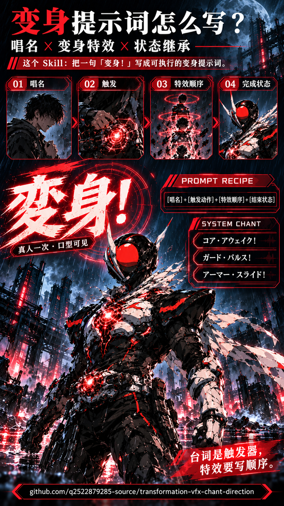

# Transformation VFX & Chant Direction

把变身写成可直接粘贴的视频提示词：**真人一次「変身！」→逐拍系统唱名→来源/路径/锁定/后果/衰减的分级特效→完成态**。普通人的情绪只作可选的一行触发，不抢主体。



## 适用场景

- 需要写变身提示词、分镜或 AI 视频输入
- 需要明确区分真人喊出的日文「変身！」与装置独立唱名
- 需要把唱名与特效写成“来源 → 路径 → 接触/锁定 → 后果 → 衰减”
- 需要宏大但不遮脸、口型、装甲边界和完整英雄轮廓的收束镜头

## 核心规则

1. 先锁定提示词格式、时长、画幅、镜头和连续性约束。
2. 普通人情绪只作可选的 1–2 拍触发，不进入主体段落。
3. 真人只清楚喊一次 **「変身！」**，装置和旁白不能代喊或重复。
4. 系统唱名独立于真人声音，每一句逐拍绑定可见动作、声音和下一状态。
5. 特效按五级升级：待机光、启动光门、分件光轨、锁止爆发、余波收束。
6. 每一拍都写清来源 → 路径 → 接触/锁定 → 后果 → 衰减，并锁住最终轮廓与完成态。

## 安装

适用于支持 `SKILL.md` 的编码 Agent：

```bash
npx skills add https://github.com/q2522879285-source/transformation-vfx-chant-direction
```

也可以把本仓库目录复制到客户端的 Skill 目录，确保最终路径为：

```text
<Skill 目录>/transformation-vfx-chant-direction/SKILL.md
```

## 直接使用

```text
用 $transformation-vfx-chant-direction，写一段可直接粘贴的原创英雄变身视频提示词。
触发动作可省略或只给 1–2 拍，然后重点输出真人一次「変身！」、逐拍系统唱名、五级特效因果链、身体重量反馈、镜头锁定和最终完成态。
```

## 文件

- [SKILL.md](SKILL.md)：Skill 主指令
- [agents/openai.yaml](agents/openai.yaml)：自动发现与 UI 元数据
- [poster.png](poster.png)：1080 × 1920 竖版一图流

## 边界

本 Skill 核心是变身提示词写法、唱名时序、特效因果和完成态可读性；情绪决断只作可选触发层。机械结构、通用特效物理、声音混音和平台语法交给对应的专业 Skill。内容使用原创机制与措辞，不复制任何既有作品的角色、口号、旋律或镜头。

## 许可证

[MIT](LICENSE) · Copyright © 2026 hong hou zi
